<div align="center">



<sub><code>PID 1</code> · <code>/home/cybersarvesh</code> · <code>runlevel: caffeinated</code></sub>

</div>

<br/>

```text
SARVESH(1)                     Primate Programmer's Manual                     SARVESH(1)

NAME
       sarvesh — a hairless ape that turns coffee into code

SYNOPSIS
       sarvesh [--react] [--nextjs] [--systems] [--pretend-to-understand-the-universe]

DESCRIPTION
       Sarvesh Mohite is a long-running userspace process that ships web apps by day
       and descends toward the kernel by night. Known to hold strong opinions about
       semicolons and weak opinions about sleep.

OPTIONS
       --react, --nextjs     Ask me anything. Stable. Production-ready.
       --systems             Currently compiling. Expect warnings. Do not expect -Werror.
       --universe            Experimental. Returns 42 or SIGSEGV, nondeterministically.

BUGS
       Occasionally mistakes "it works on my machine" for a deployment strategy.

SEE ALSO
       coffee(7), leetcode(1), hackerrank(1), stackoverflow(∞)
```

<br/>

## `$ ps aux --sort=-%brain`

| PID | USER | %BRAIN | STAT | COMMAND |
|:---:|:-----|-------:|:----:|:--------|
| `1` | sarvesh | 41.0 | `Ss` | `coffeed --daemon --refill-interval=2h` |
| `128` | sarvesh | 27.5 | `R+` | `learn systems_programming --deep --no-shortcuts` |
| `256` | sarvesh | 18.2 | `S` | `serve react nextjs --answer-questions` |
| `512` | sarvesh | 9.3 | `S` | `grind leetcode --until=enlightened` |
| `1024` | sarvesh | 4.0 | `D` | `ponder universe --verbose` <sub>⟵ uninterruptible sleep, do not disturb</sub> |

<br/>

## `$ tree ~/toolchain -L 2`

```text
~/toolchain
├── 🔩 close-to-metal/       C · C++ · Bash · Linux
├── 🎨 frontend/             React · Next.js · Redux · TypeScript · JavaScript · HTML · CSS · Sass · Tailwind
├── ⚙️  backend/              Node.js · Express · Java · Python
├── 🗄️  data/                 PostgreSQL · MySQL · MongoDB
├── 🧪 quality/              Jest · Postman
├── 📐 math/                 MATLAB
└── 🌿 vcs/                  Git          # the only thing standing between me and chaos
```

<p align="center">
  
  <br/>
  
</p>

<br/>

## `$ cat /proc/coffee/pipeline`



<br/>

## `$ neofetch`

<div align="center">



</div>

<br/>

## `$ cat /etc/hosts`

```text
# reach this process via any of the following sockets
127.0.0.1      mail        →  sarveshmohite2005@gmail.com
127.0.0.1      leetcode    →  leetcode.com/u/darth_sarvesh
127.0.0.1      hackerrank  →  hackerrank.com/sarveshmohite201
```

<p align="center">
  <a href="mailto:sarveshmohite2005@gmail.com"></a>
  <a href="https://leetcode.com/u/darth_sarvesh/"></a>
  <a href="https://www.hackerrank.com/sarveshmohite201"></a>
</p>

<br/>

<details>
<summary><code>⚠️  kernel panic — click to inspect core dump</code></summary>

<br/>

```c
/* core.c — recovered from /var/crash/sarvesh.core */

#include <coffee.h>
#include <universe.h>   /* header found, implementation missing */

struct human {
    const char *name;     /* "Sarvesh Mohite"               */
    unsigned    hair;     /* 0, by evolutionary design      */
    float       caffeine; /* must remain > 0.0f at all times */
};

int main(void) {
    struct human me = { "Sarvesh Mohite", 0, 1.0f };

    while (me.caffeine > 0.0f) {
        code();
        me.caffeine -= 0.25f;
        if (me.caffeine < 0.5f) me.caffeine += brew();
    }

    understand(universe);   /* Segmentation fault (core dumped) */
    return 42;
}
```

> If you read this far, you are now legally a contributor. Leave a ⭐ on any repo to `git commit` your visit.

</details>

<br/>

<div align="center">


<sub><code>$ shutdown -h now</code> &nbsp;·&nbsp; <i>just kidding. the coffee is still hot.</i></sub>

</div>
